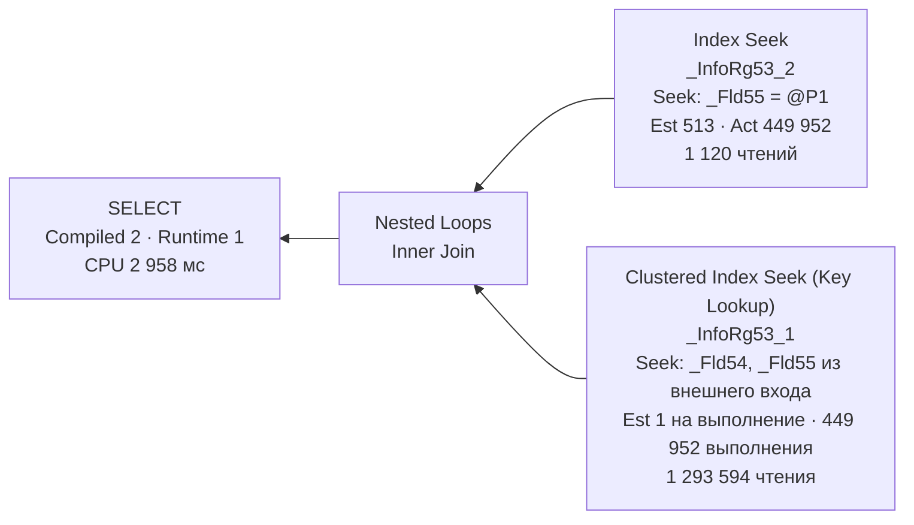
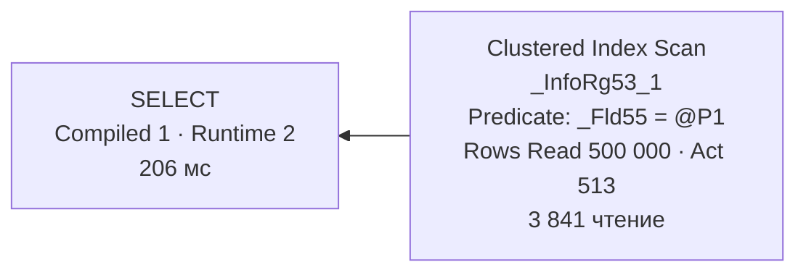

# П6. Parameter sniffing на реальном регистре 1С

[← Параллелизм на реальном плане](15-parallelism-real-plan.md) · [Оглавление](../README.md) · [Блокировки и взаимоблокировка →](17-deadlock-real-trace.md)

Эксперимент на учебной базе 1С: один и тот же запрос с отбором по складу выполнен с двумя значениями параметра в разном порядке. Значения специально выбраны с перекосом: 90% строк и 0,1% строк. Сняты фактические планы всех вызовов. На них видно всё, о чём говорят [вопросы 56–58](06-params-cache.md#56-parameter-sniffing): `ParameterCompiledValue` и `ParameterRuntimeValue`, план под первое значение, 449 952 Key Lookup вместо скана, асимметрия вреда и точка перелома по модели стоимости. Видна и ошибка постановки, после которой sniffing не проявляется вовсе.

SQL Server 2019 (15.0.2190), база `Test_1C_Opt`, платформа 1С 8.3, клиент-серверный вариант.

**Файлы планов** (откройте в SSMS, свойства по F4):

| Файл | Сценарий | План |
|---|---|---|
| [`sniff0_no_index_sklad1_scan`](../plans/sniff0_no_index_sklad1_scan.sqlplan), [`sniff0_no_index_sklad2_scan`](../plans/sniff0_no_index_sklad2_scan.sqlplan) | Попытка 1, без индекса по складу | Clustered Index Scan, TRIVIAL |
| [`sniff_a1_compiled2_run2_lookup`](../plans/sniff_a1_compiled2_run2_lookup.sqlplan) | A-1: план под склад 2, вызов со складом 2 | Index Seek + Key Lookup |
| [`sniff_a2_compiled2_run1_lookup`](../plans/sniff_a2_compiled2_run1_lookup.sqlplan) | A-2: план под склад 2, вызов со складом 1 | Index Seek + **449 952** Key Lookup |
| [`sniff_b1_compiled1_run1_scan`](../plans/sniff_b1_compiled1_run1_scan.sqlplan) | B-1: план под склад 1, вызов со складом 1 | Clustered Index Scan |
| [`sniff_b2_compiled1_run2_scan`](../plans/sniff_b2_compiled1_run2_scan.sqlplan) | B-2: план под склад 1, вызов со складом 2 | Clustered Index Scan ради 513 строк |

---

## 1. Стенд

### Регистр и таблица

Регистр сведений `ТестSniffing`, непериодический, таблица `dbo._InfoRg53`:

| Поле 1С | Колонка | Тип в СУБД | Роль |
|---|---|---|---|
| Ключ | `_Fld54` | `numeric(10,0)` | Измерение 1 |
| Склад | `_Fld55` | `numeric(5,0)` | Измерение 2, «Индексировать» (во второй попытке) |
| Количество | `_Fld56` | `numeric(15,3)` | Ресурс |
| Комментарий | — | `nvarchar(max)` | Реквизит, в запросе не участвует |

Индексы (`EXEC sp_helpindex N'dbo._InfoRg53'`):

| Индекс | Тип | Ключ | Откуда |
|---|---|---|---|
| `_InfoRg53_1` | clustered, unique | `_Fld54, _Fld55` | Измерения регистра по порядку |
| `_InfoRg53_2` | nonclustered, unique | `_Fld55, _Fld54` | Флаг «Индексировать» у измерения «Склад»: само измерение + остальные измерения ([вопрос 77](08-1c-specifics.md#77-как-индексы-объектов-1с-отображаются-в-индексы-субд)) |

Ресурса `Количество` в некластерном индексе нет. Значит, запросу, которому нужно `Количество`, после поиска по складу понадобится **Key Lookup** в кластерный индекс.

### Данные: перекос 90 / 0,1

500 000 строк. Склад 1 получил ~90% строк, остальные — случайный склад от 2 до 101.

```bsl
&НаСервереБезКонтекста
Процедура ЗаполнитьНаСервере(Всего = 500000, ДоляЦентрального = 90)
	Генератор = Новый ГенераторСлучайныхЧисел(42);
	Ключ = 0;
	Пока Ключ < Всего Цикл
		Набор = РегистрыСведений.ТестSniffing.СоздатьНаборЗаписей();
		Для н = 1 По Мин(10000, Всего - Ключ) Цикл
			Ключ = Ключ + 1;
			Запись = Набор.Добавить();
			Запись.Ключ = Ключ;
			Запись.Склад = ?(Генератор.СлучайноеЧисло(1, 100) <= ДоляЦентрального, 1, Генератор.СлучайноеЧисло(2, 101));
			Запись.Количество = Генератор.СлучайноеЧисло(1, 100000);
			Запись.Комментарий = "Строка " + Формат(Ключ, "ЧГ=");
		КонецЦикла;
		Набор.Записать(Ложь);
	КонецЦикла;
КонецПроцедуры
```

| Склад | Строк | Доля |
|---|---:|---:|
| 1 («центральный») | 449 952 | 90% |
| 2 («маленький») | 513 | 0,1% |
| 3–101 | по ~500 | по ~0,1% |

### Запрос

```bsl
ВЫБРАТЬ
	Т.Ключ,
	Т.Количество
ИЗ
	РегистрСведений.ТестSniffing КАК Т
ГДЕ
	Т.Склад = &Склад
```

Платформа отправляет его через `sp_executesql` ([вопрос 68](08-1c-specifics.md#68-как-запрос-1с-транслируется-в-sql-как-понять-объект-по-имени-таблицы)). Восстановлено по плану:

```sql
exec sp_executesql N'SELECT T1._Fld54, T1._Fld56
FROM dbo._InfoRg53 T1
WHERE (T1._Fld55 = @P1)', N'@P1 numeric(10)', 2
```

Текст одинаковый при любом складе, поэтому в кэше у запроса **одна запись**. У всех восьми планов эксперимента один `QueryHash = 0x7B5500B07077FECC`.

### Как снимали

1. Запрос выполнялся из обработки в режиме «Предприятие».
2. Фактические планы ловил Profiler: событие **Showplan XML Statistics Profile**, фильтр по базе ([вопрос 69а](08-1c-specifics.md#69а-практика-как-поймать-свой-запрос-1с-в-profiler-и-получить-его-план)).
3. Перед каждым сценарием план выбрасывался из кэша: `EXEC sp_recompile N'dbo._InfoRg53';`. Такой вызов помечает для перекомпиляции все планы, которые ссылаются на таблицу, поэтому следующий вызов компилируется заново и «подсматривает» свой параметр ([вопрос 56](06-params-cache.md#где-оптимизатор-подсматривает-значение)).
4. Два сценария:
   - **A** — сначала склад 2, потом склад 1;
   - **B** — сначала склад 1, потом склад 2.

---

## 2. Попытка 1: без индекса по складу sniffing не виден

В первой попытке у измерения «Склад» не было флага «Индексировать». Все четыре плана получились одинаковыми:

| | Склад 1 | Склад 2 |
|---|---|---|
| План | Clustered Index Scan, Predicate `_Fld55 = @P1` | то же |
| `StatementOptmLevel` | **TRIVIAL** | **TRIVIAL** |
| Estimated / Actual | 448 135 / 449 952 | 509,94 / 513 |
| Logical reads | 4 752 | 4 752 |
| Elapsed | ~1,15 с | ~0,4 с |
| `ParameterCompiledValue` / `RuntimeValue` | 1 / 1 | 2 / 2 |
| Статистика | `_WA_Sys_00000002_75A278F5`, выборка 25,22% | та же |

Что отсюда следует:
- **Выбирать не из чего.** Без индекса по складу единственный способ найти строки — прочитать всю таблицу. Оптимизатор даже не запускал стоимостный перебор, план тривиальный ([вопрос 21](03-optimizer.md#21-trivial-plan)). Sniffing есть всегда, но вредит он только тогда, когда разным значениям выгодны **разные** планы.
- **Оценки по автостатистике.** Статистику по колонке `_Fld55` сервер создал сам (`_WA_Sys_…`) по выборке 25% строк ([вопрос 33](04-statistics.md#33-автосоздание-и-автообновление-статистики-порог)). Ошибка оценки небольшая: 448 135 против 449 952, 510 против 513.

> **Урок постановки.** Чтобы воспроизвести sniffing, нужна **развилка планов**: некрывающий индекс по полю отбора и перекос значений. Индекс без перекоса или перекос без индекса проблему не покажут.

---

## 3. Что изменил флаг «Индексировать»

После включения флага и реструктуризации базы:

| | Было | Стало |
|---|---|---|
| Индексы | только `_InfoRg53_1` | + `_InfoRg53_2 (_Fld55, _Fld54)` |
| Страниц в таблице (по `ActualLogicalReads` скана) | 4 752 | **3 841** |
| Статистика по складу | `_WA_Sys_…`, выборка 25% | `_InfoRg53_2`, **100%** |
| Уровень оптимизации | TRIVIAL | **FULL** |

- **Страниц стало на 19% меньше.** Таблица при реструктуризации была перестроена, и пустое место на страницах после пакетной записи ушло. Учитывайте это, сравнивая планы «до» и «после»: изменилось не только наличие индекса, но и размер таблицы.
- **Статистика полная.** При создании индекса статистика по нему строится по всем строкам, поэтому оценки во второй попытке точные: 513 и 449 952.
- **Появилась развилка**, и оптимизатор стал выбирать по стоимости между двумя планами.

---

## 4. Попытка 2: четыре фактических плана

| | **A-1** | **A-2** | **B-1** | **B-2** |
|---|---|---|---|---|
| Порядок вызовов | 1-й в сценарии A | 2-й в сценарии A | 1-й в сценарии B | 2-й в сценарии B |
| `ParameterCompiledValue` | **2** | **2** | **1** | **1** |
| `ParameterRuntimeValue` | 2 | **1** | 1 | **2** |
| План | Seek + Key Lookup | Seek + Key Lookup | Clustered Index Scan | Clustered Index Scan |
| Estimated rows | 513 | **513** | 449 952 | **449 952** |
| Actual rows | 513 | **449 952** | 449 952 | **513** |
| Выполнений Key Lookup | 513 | **449 952** | — | — |
| Logical reads | 1 463 | **1 294 714** | 3 841 | 3 841 |
| CPU, мс | 6 | **2 958** | 712 | 206 |
| Elapsed, мс | 6 | **2 958** | 1 049 | 206 |
| Missing Index, Impact | 98,77% | 98,77% | 99,46% | 99,46% |

Жирным выделено то, что выдаёт sniffing. Это план из кэша, построенный под **другое** значение, и огромное расхождение между оценкой и фактом.

### Где это видно в SSMS

Фактический план → корневой `SELECT` → F4 → **Parameter List** ([вопрос 57](06-params-cache.md#57-диагностика)). В XML плана A-2:

```xml
<ParameterList>
  <ColumnReference Column="@P1" ParameterDataType="numeric(10,0)"
                   ParameterCompiledValue="(2.)" ParameterRuntimeValue="(1.)" />
</ParameterList>
```

План построен под склад 2, а выполняется со складом 1. Это прямое доказательство sniffing. Без него расхождение 513 / 449 952 можно было бы принять за плохую статистику, но статистика здесь полная.

---

## 5. Сценарий A: план под маленький склад на центральном складе



**Как читать.**
- `Index Seek` по `_InfoRg53_2` находит строки склада и отдаёт `_Fld54` и `_Fld55`. Вместе они дают ключ кластерного индекса.
- Для каждой строки `Nested Loops` делает поиск в кластерном индексе за `_Fld56` (`Количество`). В графическом плане это **Key Lookup**, в XML — `Clustered Index Seek` с атрибутом `Lookup="1"` ([вопрос 43](05-plans-operators.md#43-key-lookup-и-rid-lookup)).
- Оценка `Estimated Number of Rows = 1` у Lookup — на **одно** выполнение, `Estimated Number of Executions = 513`. Фактически выполнений 449 952.

**Цена.**
- **1 293 594 чтения на Lookup**, 2,875 страницы на строку. Это спуск по B-дереву глубиной 3, где корень почти всегда уже в кэше.
- Всего 1 294 714 чтений. Это **в 337 раз больше**, чем вся таблица (3 841 страница). Тот же результат план B-1 получил одним сканом.
- CPU 2 958 мс против 712 мс у скана, в 4,2 раза больше. Все страницы были в памяти. На холодном кэше 449 952 случайных чтения превратились бы в минуты.

Для склада 2 (A-1) тот же план идеален: 513 Lookup, 1 463 чтения, 6 мс.

---

## 6. Сценарий B: план под центральный склад на маленьком складе



- Для склада 1 (B-1) скан — правильный план: нужно 90% таблицы, читать её целиком дешевле всего. Elapsed 1 049 мс больше CPU 712 мс: 342 мс запрос ждал `ASYNC_NETWORK_IO`, пока клиент заберёт 449 952 строки ([кейс 7](11-case-studies.md#кейс-7-огромный-результат-сервер-ждёт-клиента)).
- Для склада 2 (B-2) тот же скан читает 500 000 строк, чтобы вернуть 513. Получается 3 841 чтение вместо 1 463 и **206 мс вместо 6**.

### Асимметрия вреда

| Чужой план | Во сколько раз хуже по чтениям | По времени | Абсолютно |
|---|---:|---:|---|
| Под маленький склад на центральном (A-2 против B-1) | **337×** | CPU в 4,2× | +2,2 с CPU, растёт с объёмом |
| Под центральный на маленьком (B-2 против A-1) | 2,6× | 34× | +0,2 с, ограничено размером таблицы |

Плохой скан ограничен сверху: хуже, чем «прочитать таблицу целиком», он не станет. Плохой Nested Loops + Lookup ограничен только числом строк. Поэтому опаснее всего, когда **первым после сброса кэша** приходит вызов с маленьким значением. А маленьких складов здесь сто из ста одного.

---

## 7. Точка перелома по модели стоимости

Где оптимизатор переключается с Seek + Lookup на скан, можно посчитать по оценкам из этих же планов ([вопрос 42](05-plans-operators.md#42-table-scan-clustered-index-scan-index-seek-всегда-ли-scan--плохо), [вопрос 19](03-optimizer.md#19-что-такое-стоимость-плана)):

| Составляющая | Где взять | Значение |
|---|---|---:|
| Стоимость скана | `EstimatedTotalSubtreeCost` скана (B-1) | 3,38662 |
| Стоимость Lookup на 513 выполнений | `EstimatedTotalSubtreeCost` Lookup (A-1) | 1,57885 |
| Lookup на одну строку | 1,57885 / 513 | ≈ 0,00308 |
| + Seek и Nested Loops на строку | (0,00405 + 0,00214) / 513 | ≈ 0,00001 |
| **Перелом** | 3,38662 / 0,00309 | **≈ 1 100 строк** |

1 100 строк — это **0,22%** таблицы. Таблица узкая (130 строк на страницу), скан дешёвый, поэтому перелом наступает раньше, чем 0,4% из примера в вопросе 42. Склады 2–101 (~500 строк) лежат ниже перелома, им выгоден Seek. Склад 1 лежит намного выше, ему выгоден скан. Развилка налицо.

> **По плотности.** Если значение не подсмотрено (локальная переменная в SSMS, `OPTIMIZE FOR UNKNOWN`), оценка идёт по плотности: 500 000 / 101 склад ≈ 4 950 строк ([вопрос 32](04-statistics.md#гистограмма-или-плотность)). Это выше перелома, и по расчёту получится скан для любого склада. Поэтому запрос 1С нельзя проверять в SSMS через `DECLARE @P1`: вы увидите не тот план, который получает 1С. Этот вариант в эксперименте не снимался, это вывод из модели стоимости.

---

## 8. Missing Index и что можно сделать в 1С

Все четыре плана просят один и тот же индекс:

```sql
CREATE NONCLUSTERED INDEX … ON dbo._InfoRg53 (_Fld55) INCLUDE (_Fld56);   -- Impact 98,8–99,5%
```

Это `_InfoRg53_2`, к которому добавлено `Количество`. С таким индексом **развилка исчезает**: для любого склада получится Seek без Lookup, для склада 1 — упорядоченное чтение 90% узкого индекса. Один план хорош для всех, и sniffing перестаёт быть проблемой. Это лучший способ из [вопроса 58](06-params-cache.md#58-способы-борьбы-плюсы-и-минусы).

Но в 1С так просто не сделать:

| Способ | Применимость здесь |
|---|---|
| Индекс с `INCLUDE (_Fld56)` вручную в СУБД | Платформа о нём не знает. Реструктуризация может его удалить, и такое изменение базы не поддерживается. Для рабочей базы — нет ([вопрос 54](05-plans-operators.md#54--почему-нельзя-слепо-создавать-индексы-по-missing-index)) |
| Убрать `Количество` из запроса | Если ресурс не нужен, `_InfoRg53_2` становится покрывающим: Seek для всех значений |
| Разные тексты запроса для «центрального» и прочих складов | Разный текст — разные записи в кэше и свой план у каждой. Цена: знать границу и сопровождать две ветки |
| Query Store: закрепить план скана | Худший случай для маленького склада — 206 мс вместо 2 958 мс для большого. Минимакс, но ценой 3 841 чтения на каждый вызов |
| PSP optimization | Только SQL Server 2022 и уровень совместимости 160. На 2019 недоступно |
| `sp_recompile`, обновление статистики | Перезапуск лотереи, а не лечение: следующий первый вызов снова определит план |

---

## 9. Как повторить и что проверить

1. Создать регистр со **составным** ключом и некрывающим индексом по полю отбора. Заполнить с перекосом.
2. Включить в Profiler `Showplan XML Statistics Profile`, фильтр по базе. Без SPID, если 1С и SSMS на одной машине ([вопрос 69а](08-1c-specifics.md#69а-практика-как-поймать-свой-запрос-1с-в-profiler-и-получить-его-план)).
3. `EXEC sp_recompile N'dbo._InfoRg53';` → вызов с маленьким значением → вызов с большим.
4. `EXEC sp_recompile N'dbo._InfoRg53';` → вызов с большим значением → вызов с маленьким.
5. В каждом плане проверить:
   - `ParameterCompiledValue` и `ParameterRuntimeValue` в `Parameter List`;
   - `Estimated` и `Actual` rows у Index Seek и `Number of Executions` у Key Lookup;
   - `StatementOptmLevel`: при `TRIVIAL` развилки нет, эксперимент поставлен неверно;
   - `OptimizerStatsUsage`: какая статистика и с какой выборкой;
   - `ActualLogicalReads` по операторам: сумма против размера таблицы.

**Признаки sniffing в чужом плане** — те же, что в A-2:
- Compiled ≠ Runtime;
- оценка верна для Compiled-значения и неверна для Runtime;
- статистика при этом свежая и полная.

Если `Compiled = Runtime`, а оценка всё равно далека от факта, причина не в sniffing, а в статистике ([вопрос 39](04-statistics.md#39--ошибка-оценки-кардинальности-как-найти-и-почему-она-главная)).

---

[← Параллелизм на реальном плане](15-parallelism-real-plan.md) · [Оглавление](../README.md) · [Блокировки и взаимоблокировка →](17-deadlock-real-trace.md)
