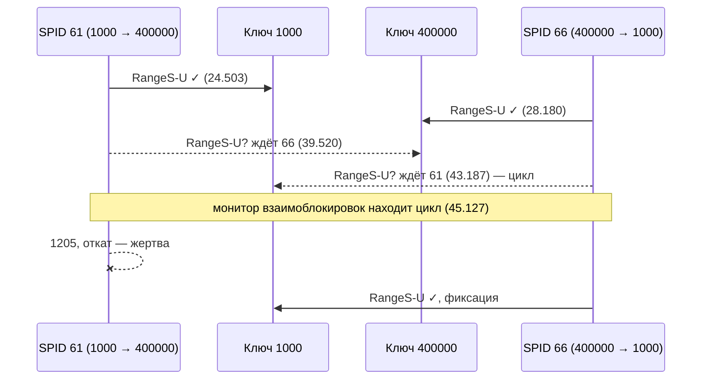

# П7. Блокировки и взаимоблокировка на реальной трассе 1С

[← Parameter sniffing на реальном регистре](16-sniffing-real-plans.md) · [Оглавление](../README.md) · [Spill на реальном плане →](18-spill-real-plans.md)

Эксперимент: получить в 1С **взаимоблокировку на уровне СУБД** (deadlock, ошибка 1205) и разобрать её граф. Путь к результату оказался длинным, и каждая неудачная попытка показала что-то полезное. Ожидание без цикла — это 1222, а не 1205. Соседние ключи блокируются диапазоном. Ошибка без `native` пришла не от SQL Server. Регистр в автоматическом режиме нельзя писать в управляемой транзакции. Ниже сначала карта ошибок, потом попытки по порядку, потом разбор графа.

Стенд тот же, что в [П6](16-sniffing-real-plans.md#1-стенд): регистр сведений `ТестSniffing`, таблица `dbo._InfoRg53`, 500 000 строк, **режим блокировки регистра — автоматический**. SQL Server 2019, платформа 8.3, два сеанса 1С в режиме «Предприятие».

Теория — [вопрос 67](07-profiler-metrics.md#67--как-отличить-медленный-запрос-от-запроса-который-ждёт-блокировку), [кейс 4](11-case-studies.md#кейс-4-запрос-висит-35-секунд-не-потребляя-ресурсов) и [кейс 12](11-case-studies.md#кейс-12-1с-расследование-возможных-блокировок).

**Файл графа:** [`traces/deadlock_1c_for_update_rangesu.xdl`](../traces/deadlock_1c_for_update_rangesu.xdl). SSMS откроет его как схему.

---

## 1. Карта ошибок, которые встретились

| Текст в 1С (суть) | `native` / SQLSTATE | Кто выдал | Что произошло | Где видно |
|---|---|---|---|---|
| «Превышено время ожидания запроса на блокировку» | **1222** / `HYT00` | SQL Server | Ждали чужую блокировку дольше `LOCK_TIMEOUT` (у 1С — 20 с). **Цикла нет**, это очередь | Profiler: `Lock:Timeout (timeout > 0)`; DMV во время ожидания |
| «…стала жертвой взаимоблокировки. Запустите транзакцию повторно» | **1205** / `40001` | SQL Server | **Цикл** ожиданий. Сервер выбрал жертву и откатил её транзакцию | Profiler: `Deadlock graph`, `Lock:Deadlock`, `Exception 1205`; `system_health` |
| «Неустранимый конфликт блокировок» | нет | Сервер 1С | Текст без ошибки SQL Server, в Profiler графа нет. Источник в эксперименте не подтверждён, см. [попытку 2](#попытка-2-далёкие-ключи-и-запись-наборов-неустранимый-конфликт-блокировок) | ТЖ: `TDEADLOCK`, `TLOCK` |
| «Ошибка использования Менеджера блокировок. Автоматический режим блокировки недопустим в этой транзакции» | нет | Сервер 1С | Объект с автоматическим режимом блокировки записывают в транзакции, открытой в управляемом режиме | Стек ошибки 1С |

**Главное различие 1222 и 1205.** Таймаут означает, что сеанс долго стоял в очереди и сдался сам. Дедлок означает, что двое ждут друг друга и без вмешательства не дождутся никогда. SQL Server находит цикл за несколько секунд, не дожидаясь `LOCK_TIMEOUT`.

В тексте ошибки 1С `Severity` указан **в шестнадцатеричном виде**: `Severity=10` у 1222 — это 16, `Severity=D` у 1205 — это 13.

---

## 2. Попытки по порядку

### Попытка 1. Встречная запись наборов, соседние ключи: очередь, а не цикл

Два сеанса в транзакциях записывали наборы регистра по двум ключам **в разном порядке**: сеанс 1 — ключ 1, пауза, ключ 2; сеанс 2 — ключ 2, пауза, ключ 1.

Результат — ошибка **1222**, графа взаимоблокировки нет. Во время ожидания в `sys.dm_exec_requests`:

```text
session 66, blocking 52, wait_type LCK_M_RX_X, wait_time 16 435 мс
waitresource KEY: 11:72057594052935680 (3bb1a90a9c48)
(@P1 numeric(10))DELETE FROM T1 FROM dbo._InfoRg53 T1 WITH(SERIALIZABLE) WHERE T1._Fld54 = @P1
```

В Profiler — `Lock:Timeout (timeout > 0)` с режимом **RangeS-S** на ключе того же индекса.

Что видно:
- `Набор.Записать()` в автоматической транзакции — это `DELETE … WITH(SERIALIZABLE)` старых записей, затем `INSERT` ([кейс 12](11-case-studies.md#кейс-12-1с-расследование-возможных-блокировок)). Хинт `SERIALIZABLE` означает **блокировки диапазона ключей** (`RangeS-S`, `RangeX-X`, ожидание `LCK_M_RX_X`).
- Блокировка диапазона по условию `_Fld54 = 1` захватывает и **следующий ключ** за диапазоном, то есть строку с ключом 2. Так сервер не даёт вставить «фантомную» строку в промежуток. Подробно — в [разделе 5](#5-почему-ranges-u-при-поиске-по-одному-ключу).
- Поэтому второй сеанс упирается в первый уже на **первом** шаге, а не после паузы. Получается очередь: первый держит, второй ждёт. Цикла нет, и через 20 с — 1222.

**Вывод для опыта:** ключи участников должны быть **далеко друг от друга** (1000 и 400000), иначе их диапазоны пересекутся раньше, чем нужно.

### Попытка 2. Далёкие ключи и запись наборов: «Неустранимый конфликт блокировок»

Та же процедура с ключами 1000 и 400000, транзакция `НачатьТранзакцию()` без параметра. Один из сеансов получил на `Набор.Прочитать()`:

```text
Конфликт блокировок при выполнении транзакции:
Неустранимый конфликт блокировок
```

В тексте нет `Microsoft OLE DB Driver…` и нет `native=…`, а в Profiler не было `Deadlock graph` и `Exception 1205`. Сравните с ошибкой в [разделе 4](#ошибка-в-сеансе-жертве): когда цикл находит SQL Server, 1С дословно приводит его сообщение и код.

Вероятнее всего, цикл обнаружил менеджер блокировок сервера 1С, а не СУБД. В этом эксперименте это **не подтверждено**: технологический журнал не включали. Проверка — событие `TDEADLOCK` в ТЖ (свойство `DeadlockConnectionIntersections`) и отсутствие записи `xml_deadlock_report` в `system_health` на это время.

### Попытка 3. Разные режимы транзакций: ошибка менеджера блокировок

Идея: один сеанс в автоматическом режиме, другой — в управляемом с `БлокировкаДанных`. Управляемый сеанс упал сразу, на `Набор.Записать()`:

```text
Ошибка использования Менеджера блокировок
Автоматический режим блокировки недопустим в этой транзакции.
```

У регистра стоит режим блокировки «Автоматический». Записать такой объект в транзакции, открытой с `РежимУправленияБлокировкойДанных.Управляемый`, платформа не даёт. Смешать режимы в одном опыте можно только так: у регистра «Управляемый» (и конфигурация в режиме «Автоматический и управляемый»), либо второй участник работает в обход 1С, например из SSMS.

### Попытка 4. `ДЛЯ ИЗМЕНЕНИЯ` в обратном порядке: взаимоблокировка СУБД

Почему сработало:
- обычное чтение в автоматической транзакции берёт **S**-блокировки, а S совместима с S. Два читателя друг другу не мешают;
- `ДЛЯ ИЗМЕНЕНИЯ` в автоматическом режиме платформа превращает в хинт `UPDLOCK`. **U** несовместима с U, поэтому второй «читатель для изменения» ждёт первого;
- никаких `DELETE`/`INSERT` в середине: конфликт возникает на первом же операторе, цикл получается чистый.

```bsl
&НаСервереБезКонтекста
Процедура ДедлокСУБДНаСервере(ПервыйКлюч, ВторойКлюч, ПаузаСек = 15)
	НачатьТранзакцию(РежимУправленияБлокировкойДанных.Автоматический);
	Попытка
		ЗахватитьКлюч(ПервыйКлюч);
		Конец = ТекущаяУниверсальнаяДатаВМиллисекундах() + ПаузаСек * 1000;
		Пока ТекущаяУниверсальнаяДатаВМиллисекундах() < Конец Цикл КонецЦикла;
		ЗахватитьКлюч(ВторойКлюч);
		ЗафиксироватьТранзакцию();
	Исключение
		ОтменитьТранзакцию();
		ВызватьИсключение;
	КонецПопытки;
КонецПроцедуры

&НаСервереБезКонтекста
Процедура ЗахватитьКлюч(Ключ)
	Запрос = Новый Запрос(
	"ВЫБРАТЬ
	|	Т.Количество
	|ИЗ
	|	РегистрСведений.ТестSniffing КАК Т
	|ГДЕ
	|	Т.Ключ = &Ключ
	|ДЛЯ ИЗМЕНЕНИЯ");
	Запрос.УстановитьПараметр("Ключ", Ключ);
	Запрос.Выполнить();
КонецПроцедуры
```

Сеанс 1 вызывает `ДедлокСУБДНаСервере(1000, 400000)`, через 2–5 секунд сеанс 2 вызывает `ДедлокСУБДНаСервере(400000, 1000)`. Пауза ожидания сделана циклом, потому что за 15 с нужно успеть переключиться в другое окно.

SQL, который отправила платформа (событие `RPC:Starting`):

```sql
exec sp_executesql N'SELECT
T1._Fld56
FROM dbo._InfoRg53 T1 WITH(SERIALIZABLE, UPDLOCK)
WHERE (T1._Fld54 = @P1)',N'@P1 numeric(10)',1000
```

`ДЛЯ ИЗМЕНЕНИЯ` → `UPDLOCK`, автоматическая транзакция → `SERIALIZABLE`.

> ⚠️ **Распространённая ошибка в готовых рецептах.** В языке запросов 1С нет конструкции `Блокировка ИЗМЕНЕНИЕ`, правильно — `ДЛЯ ИЗМЕНЕНИЯ`. В управляемом режиме она игнорируется. «Подготовка данных» через `Набор.Очистить()` + `Записать()` без отбора перезаписывает **весь** регистр.

---

## 3. Что в трассе

События Profiler в момент обнаружения (11:17:45.127):

| Событие | SPID | Что содержит |
|---|---|---|
| `Lock:Deadlock Chain` | 61 | Участник цикла: ресурс `KEY (05c91ec5daa6)`, режим **RangeS-U** |
| `Lock:Deadlock Chain` | 66 | Участник цикла: ресурс `KEY (bc498c599fe7)`, режим **RangeS-U** |
| `Lock:Deadlock` | 61 | Запрос блокировки жертвы отменён. StartTime 11:17:39.517: с этого момента SPID 61 ждал |
| `Exception` | 61 | Error **1205**, severity 13 |
| `User Error Message` | 61 | «Транзакция (идентификатор процесса 61) вызвала взаимоблокировку…» |
| `Deadlock graph` | — | XML графа. Приходит от **системного** процесса, поэтому фильтр по SPID его отсекает |

Набор событий для таких опытов:
- `Locks`: `Deadlock graph`, `Lock:Deadlock`, `Lock:Deadlock Chain`, `Lock:Timeout (timeout > 0)`;
- `Errors and Warnings`: `Exception`, `User Error Message` — номер ошибки, 1205 или 1222;
- `Stored Procedures`: `RPC:Starting` / `RPC:Completed` — значения параметров (в графе их нет).

Showplan-события здесь только мешают. Без фильтра по SPID; фильтр по `DatabaseName` к `Deadlock graph` не применять.

**Как сохранить.**
- Всю трассу: *File → Save As → Trace XML File*.
- Только графы: *File → Export → Extract SQL Server Events → Extract Deadlock Events*. Можно одним файлом или каждый граф в свой `.xdl`.
- *Extract Showplan Events* сохраняет **только планы**, без событий трассы.

---

## 4. Разбор графа

```xml
<deadlock victim="process24490075468">
 <process-list>
  <process id="process24490075468" spid="61" lockMode="RangeS-U" waittime="5606"
           waitresource="KEY: 11:72057594052935680 (05c91ec5daa6)"
           lasttranstarted="2026-10-11T11:17:24.503" lastbatchstarted="2026-10-11T11:17:39.520"
           logused="0" isolationlevel="repeatable read (3)" lockTimeout="20000"
           clientapp="1CV83 Server" trancount="1">
   <executionStack><frame procname="adhoc" …>unknown</frame></executionStack>
   <inputbuf>(@P1 numeric(10))SELECT T1._Fld56 FROM dbo._InfoRg53 T1 WITH(SERIALIZABLE, UPDLOCK)
             WHERE (T1._Fld54 = @P1)</inputbuf>
  </process>
  <process id="process2449005d468" spid="66" lockMode="RangeS-U" waittime="1941"
           waitresource="KEY: 11:72057594052935680 (bc498c599fe7)"
           lasttranstarted="2026-10-11T11:17:28.180" lastbatchstarted="2026-10-11T11:17:43.187" … />
 </process-list>
 <resource-list>
  <keylock indexname="_InfoRg53_1" mode="RangeS-U">   <!-- (05c91ec5daa6) -->
   <owner-list><owner id="process2449005d468" mode="RangeS-U"/></owner-list>
   <waiter-list><waiter id="process24490075468" mode="RangeS-U" requestType="wait"/></waiter-list>
  </keylock>
  <keylock indexname="_InfoRg53_1" mode="RangeS-U">   <!-- (bc498c599fe7) -->
   <owner-list><owner id="process24490075468" mode="RangeS-U"/></owner-list>
   <waiter-list><waiter id="process2449005d468" mode="RangeS-U" requestType="wait"/></waiter-list>
  </keylock>
 </resource-list>
</deadlock>
```

### Хеши ключей → строки

Хеш в `waitresource` переводится в строку недокументированной функцией `%%lockres%%` ([кейс 12](11-case-studies.md#кейс-12-1с-расследование-возможных-блокировок)):

```sql
SELECT %%lockres%% AS lockres, _Fld54 AS Ключ
FROM dbo._InfoRg53 WITH (NOLOCK)
WHERE %%lockres%% IN (N'(05c91ec5daa6)', N'(bc498c599fe7)');
```

| lockres | Ключ |
|---|---:|
| `(bc498c599fe7)` | 1000 |
| `(05c91ec5daa6)` | 400000 |

Запрос считает хеш для каждой строки, на 500 000 строках это несколько секунд. `hobt_id = 72057594052935680` → `_InfoRg53_1`: в графе индекс указан и так, в `indexname`.

### Хронология

| Время | SPID 61, вызов `(1000, 400000)` | SPID 66, вызов `(400000, 1000)` |
|---|---|---|
| 11:17:24.503 | Транзакция, `SELECT … UPDLOCK` ключа **1000** → держит `RangeS-U` | |
| 11:17:28.180 | | Транзакция, ключ **400000** → держит `RangeS-U` |
| 11:17:39.520 | Пауза кончилась, просит **400000** → ждёт SPID 66 | |
| 11:17:43.187 | | Просит **1000** → ждёт SPID 61 → **цикл** |
| 11:17:45.127 | **Жертва**: 1205, откат | Получил ключ 1000, транзакция завершилась |



### Что говорят поля

| Поле | Значение | Вывод |
|---|---|---|
| `lockMode="RangeS-U"` | Блокировка диапазона: S на промежуток перед ключом, U на сам ключ | `SERIALIZABLE` + `UPDLOCK`. U несовместима с U, отсюда конфликт |
| `waittime` у 66 = **1941** мс | Цикл замкнулся в 43.187, найден в 45.127 | Монитор взаимоблокировок проверяет граф ожиданий периодически: по умолчанию раз в 5 с, после найденных дедлоков чаще. Цикл живёт до проверки |
| `waittime` у 61 = 5606 мс | Ждал с 39.520 | Жертвой стал не тот, кто замкнул цикл |
| `logused="0"` у обоих | Ни один ещё ничего не записал | Жертву выбирают по `DEADLOCK_PRIORITY`, затем по стоимости отката. Здесь они равны, и выбор — на усмотрение сервера. В обоих наших запусках жертвой оказался сеанс, начавший первым, но гарантии этого нет |
| `isolationlevel="repeatable read (3)"` | Уровень **сеанса** | Платформа держит транзакцию на REPEATABLE READ и поднимает до SERIALIZABLE **хинтом на таблицу**. В графе виден уровень сеанса, а не хинт |
| `lockTimeout="20000"` | `SET LOCK_TIMEOUT 20000` от 1С | Без цикла сеанс ждал бы 20 с и получил 1222, как в попытке 1 |
| `executionStack` → `unknown` | У фрейма есть `sqlhandle`, но текст в граф не попал | Текст берите из `inputbuf` или по `sqlhandle` из `sys.dm_exec_sql_text`, пока план в кэше |
| `inputbuf` | Последний пакет сеанса, **без значений** `@P1` | Какие ключи участвовали, графа мало: нужны хеши + `%%lockres%%` или `RPC:Starting` в трассе |
| `clientapp="1CV83 Server"`, `hostpid` одинаковый | Оба процесса — соединения одного сервера 1С | По SPID пользователя не найти. Нужна консоль кластера или ТЖ `DBMSSQL` с `dbpid` ([кейс 12](11-case-studies.md#кейс-12-1с-расследование-возможных-блокировок)) |

### Ошибка в сеансе-жертве

Сеанс 1С, выбранный жертвой, получает:

```text
{Обработка.ТестоваяОбработка.Форма.Форма.Форма(79)}: Ошибка при вызове метода контекста (Выполнить)
Ошибка выполнения запроса
Конфликт блокировок при выполнении транзакции:
Microsoft OLE DB Driver for SQL Server: Транзакция (идентификатор процесса 66) вызвала взаимоблокировку
ресурсов блокировка с другим процессом и стала жертвой взаимоблокировки. Запустите транзакцию повторно.
HRESULT=80004005, SQLSrvr: SQLSTATE=40001, state=33, Severity=D, native=1205, line=1
```

Стек: `ДедлокСУБДНаСервере(1000, 400000)` → `ЗахватитьКлюч(ВторойКлюч)` → `Запрос.Выполнить()`. Ошибка возникает на **втором** захвате, когда сеанс уже ждёт.

Этот текст снят в повторном запуске, где тот же вызов `(1000, 400000)` выполнялся на соединении с SPID 66, а не 61. Это нормально: сервер 1С держит пул соединений с СУБД, и **SPID не закреплён за сеансом 1С**. Сопоставлять граф и ошибку 1С нужно по времени и тексту запроса, а не по номеру процесса.

---

## 5. Почему RangeS-U при поиске по одному ключу

Условие `_Fld54 = @P1` выглядит как точечный поиск, а SQL Server всё равно взял **блокировку диапазона**. Причина — в индексе:

```text
_InfoRg53_1   clustered, unique   (_Fld54, _Fld55)    -- Ключ, Склад
```

У регистра **два измерения**, и уникален только их **набор**. Условие только по первому измерению — это поиск по **префиксу** составного ключа. Сервер не знает, что строка с `Ключ = 1000` одна, поэтому выполняет поиск диапазона. Под `SERIALIZABLE` такой поиск блокирует:
- каждую найденную строку — `RangeS-U` (промежуток перед ключом + сам ключ);
- **следующий ключ** после диапазона — чтобы никто не вставил новую строку с `Ключ = 1000`.

При поиске по **всем** столбцам уникального ключа и существующей строке хватило бы обычной блокировки ключа, без диапазона.

Следствия для 1С:
- запись или чтение `ДЛЯ ИЗМЕНЕНИЯ` регистра сведений по части измерений в автоматическом режиме блокирует **соседний** ключ. Это и сорвало попытку 1 с ключами 1 и 2;
- чем меньше отбор совпадает с ключом индекса, тем шире блокировка. При отборе по неиндексированному полю — скан и блокировка всей таблицы, вплоть до эскалации ([кейс 12](11-case-studies.md#кейс-12-1с-расследование-возможных-блокировок)).

| Запрошено ↓ / Удерживается → | RangeS-S | RangeS-U |
|---|---|---|
| **RangeS-S** (обычное чтение) | совместимо | совместимо |
| **RangeS-U** (`ДЛЯ ИЗМЕНЕНИЯ`) | совместимо | **конфликт** |

Поэтому встречное **чтение** двух сеансов не даёт ни ожидания, ни дедлока, а встречное чтение `ДЛЯ ИЗМЕНЕНИЯ` даёт.

---

## 6. Где ещё лежит граф: `system_health`

Сессия Extended Events `system_health` работает на сервере по умолчанию и записывает каждый `xml_deadlock_report`. Profiler для этого не нужен.

```sql
-- 1. Где лежат файлы сессии
SELECT t.target_name, CAST(t.target_data AS xml) AS target_data
FROM sys.dm_xe_sessions s
JOIN sys.dm_xe_session_targets t ON t.event_session_address = s.address
WHERE s.name = N'system_health';

-- 2. Графы из файлов (путь — из шага 1)
SELECT CAST(event_data AS xml).value('(event/@timestamp)[1]', 'datetime2') AS ts_utc,
       CAST(event_data AS xml).query('(event/data/value/deadlock)[1]')  AS deadlock_graph
FROM sys.fn_xe_file_target_read_file(
       N'D:\SQL\MSSQL15.MSSQLSERVER\MSSQL\Log\system_health*.xel', NULL, NULL, NULL)
WHERE object_name = N'xml_deadlock_report'
ORDER BY ts_utc DESC;
```

Подводные камни, на которых споткнулся эксперимент:
- **относительный путь** `N'system_health*.xel'` ищет файлы в каталоге журналов по умолчанию. Если сервер пишет в другой каталог, запрос молча вернёт пустой результат. Берите полный путь из `target_data` (`<File name="…">`);
- **время в UTC**: дедлок в 11:17 по Владивостоку (UTC+10) лежит под 01:17;
- **кольцевой буфер** (`ring_buffer`) лучше фильтровать на сервере (`nodes('RingBufferTarget/event[@name="xml_deadlock_report"]')`). Если выгрузить его целиком, SSMS обрежет XML на 2 МБ, а 5 000 событий буфера — это в основном служебный шум;
- графы и события старше нескольких дней вытесняются: у `system_health` ограничен размер и число файлов.

---

## 7. Как лечат такие взаимоблокировки в 1С

Цикл здесь искусственный, но в рабочей базе он устроен так же: две транзакции захватывают одни и те же ресурсы в разном порядке.

| Мера | Почему помогает |
|---|---|
| **Единый порядок захвата**: сортировать ключи перед блокировкой и записью | Цикл невозможен, остаётся очередь: второй дождётся первого |
| **Управляемый режим** + `БлокировкаДанных` «Исключительный» **до** чтения | Конфликт решает менеджер блокировок 1С на сервере, а не СУБД. Чтения идут без блокировок СУБД (версии строк), диапазонов `SERIALIZABLE` нет |
| `ДЛЯ ИЗМЕНЕНИЯ` / U-блокировка при «прочитать, потом изменить» в автоматическом режиме | Убирает классический дедлок «оба держат S, оба просят X». Но, как видно здесь, не защищает от разного порядка захвата |
| Короткие транзакции: расчёты, проверки, обмены — до `НачатьТранзакцию()` | Меньше окно, в котором можно встретиться |
| Отбор, совпадающий с ключом индекса | Блокируется меньше строк и соседних ключей |
| Повтор транзакции после 1205 | Ошибка честно предлагает «запустите повторно». Это заплатка, а не лечение |

---

## 8. Чек-лист: блокировка или взаимоблокировка в 1С

1. **Текст ошибки.** Есть `native=1222` — очередь, ищите голову цепочки ([кейс 4](11-case-studies.md#кейс-4-запрос-висит-35-секунд-не-потребляя-ресурсов)). `native=1205` — цикл СУБД, нужен граф. Нет `native` — ошибка сервера 1С, смотрите ТЖ (`TLOCK`, `TTIMEOUT`, `TDEADLOCK`).
2. **Граф** — из `system_health` (полный путь к файлам) или из трассы с `Deadlock graph` без фильтра по SPID.
3. **В графе:**
   - `resource-list` — какие ресурсы и в каких режимах, кто владелец, кто ждёт;
   - `waitresource` → `hobt_id` → индекс, хеш → строка через `%%lockres%%`;
   - `inputbuf` — какой оператор, режим `S`, `U`, `X` или `Range…`.
4. **Значения параметров** — из `RPC:Starting` в трассе или из ТЖ `DBMSSQL`. В графе их нет.
5. **Порядок захвата** у участников: одинаковые ресурсы в разном порядке — причина цикла.
6. **Режимы блокировок** у объектов 1С и транзакций: автоматический даёт `SERIALIZABLE` и диапазоны, управляемый — блокировки сервера 1С.
7. **Исправление** — единый порядок, управляемые блокировки до чтения, короткие транзакции. Проверка: ни 1205 в трассе, ни `xml_deadlock_report` в `system_health` при той же нагрузке.

---

[← Parameter sniffing на реальном регистре](16-sniffing-real-plans.md) · [Оглавление](../README.md) · [Spill на реальном плане →](18-spill-real-plans.md)
