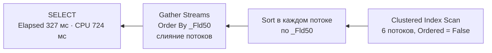

# П9. Sort в запросах 1С: девять опытов

[← Spill на реальном плане](18-spill-real-plans.md) · [Оглавление](../README.md) · [Статистика регистра 1С →](20-statistics-1c-real-walkthrough.md)

Девять коротких опытов на регистре сведений с 500 000 строк. Цель — увидеть, **когда Sort появляется, когда его нет и сколько он стоит**. Проверено и утверждение из теории про порог Top N Sort. Часть прогнозов не подтвердилась, и это отмечено так же, как подтверждения.

Теория — [вопрос 48 (как читать Sort)](05-plans-operators.md#как-читать-оператор-sort-в-плане), [вопрос 50а (ORDER BY и GROUP BY)](05-plans-operators.md#50а-выполнение-запросов-с-order-by-и-с-агрегацией-операторы-и-роль-индексов). Spill — в [П8](18-spill-real-plans.md).

**Стенд.** Регистр сведений `ТестSniffing` с теми же данными, что в [П6](16-sniffing-real-plans.md#1-стенд), но **в другой базе**: таблица `dbo._InfoRg47`, SQL Server 2019 (сборка 15.0.2130). Номера колонок поэтому другие:

| Поле 1С | Колонка | Индексы |
|---|---|---|
| Ключ | `_Fld48` | `_InfoRg47_1` — кластерный `(Ключ, Склад)` |
| Склад | `_Fld49` | `_InfoRg47_2` — `(Склад, Ключ)`, флаг «Индексировать» |
| Количество | `_Fld50` | нет |
| Комментарий | `_Fld55` | нет |

Склад 1 — 449 952 строки, склад 2 — 513, остальные по ~500. Планы сняты событием `Showplan XML Statistics Profile`, все 22 файла — `plans/sort*.sqlplan`.

---

## Сводка

| № | Запрос (суть) | Sort? | Что показал | Прогноз |
|---|---|---|---|---|
| 1 | `ПЕРВЫЕ 1000 … УПОРЯДОЧИТЬ ПО Ключ [УБЫВ]` | нет | Порядок из кластерного индекса, row goal: 32 чтения | ✅ |
| 2а | `ГДЕ Склад = 2 УПОРЯДОЧИТЬ ПО Ключ` (только Ключ) | нет | Порядок из индекса `(Склад, Ключ)` после равенства | ✅ |
| 2б | То же, но `УПОРЯДОЧИТЬ ПО Количество` | **да** | Seek + Lookup + Sort 513 строк | ✅ |
| 3 | `ПЕРВЫЕ 100 / 101 / 10000 / 100000 … ПО Количество УБЫВ` | **да** | **Порог Top N Sort: 100 → 101 — память с 1 МБ до 83 МБ** | ✅ ★ |
| 4 | Все 500 000 строк `ПО Количество` | **да** | Параллельный Sort + Gather Streams с `Order By` | ✅ |
| 5а | `РАЗЛИЧНЫЕ Склад` | нет | Stream Aggregate по упорядоченному индексу | ✅ |
| 5б | `РАЗЛИЧНЫЕ Количество` | нет (Hash) | Hash Match (Aggregate), 99 320 групп | ✅ |
| 6 | `ОБЪЕДИНИТЬ` против `ОБЪЕДИНИТЬ ВСЕ` | нет | Устранение дублей **слиянием без Sort**, почти бесплатно | ❌ ждали Sort/Hash |
| 7а–в | `СГРУППИРОВАТЬ ПО Склад` / + `УПОРЯДОЧИТЬ` / по Количеству | в 7б | Sort **после** агрегата, по 101 строке — но выдано 86 МБ | ✅ / ⚠️ |
| 8 | `ПЕРВЫЕ 101` по строке против числа | **да** | По строке **быстрее** | ❌ ждали наоборот |
| 9 | ВТ `ИНДЕКСИРОВАТЬ ПО Количество` + выборка из ВТ | в INSERT | Sort переехал в заполнение ВТ | ✅ (в деталях иначе) |
| — | «Лишние» планы в трассе | **да** | `STATMAN`: построение статистики при компиляции | находка |

---

## 1–2. Когда Sort не нужен

**Опыт 1.** `ВЫБРАТЬ ПЕРВЫЕ 1000 Т.Ключ, Т.Количество … УПОРЯДОЧИТЬ ПО Т.Ключ` — и второй прогон с `УБЫВ`.

| | По возрастанию | `УБЫВ` |
|---|---|---|
| План | Top ← Clustered Index Scan, `Ordered = True`, `FORWARD` | то же, `BACKWARD` |
| Прочитано строк / чтений | 1 000 / 32 | 1 000 / 34 |
| Память | 0 | 0 |

Кластерный индекс начинается с `Ключ` — строки уже лежат в нужном порядке. Sort нет, а цель по числу строк (row goal) остановила скан через 1 000 строк из 500 000. Обратный порядок тоже бесплатен: B-дерево читается в обе стороны.

**Опыт 2.** Отбор `ГДЕ Склад = &Склад` (склад 2), два варианта сортировки.

| | 2а: `УПОРЯДОЧИТЬ ПО Ключ`, выбран только Ключ | 2б: `УПОРЯДОЧИТЬ ПО Количество` |
|---|---|---|
| План | Index Seek по `(Склад, Ключ)`, `Ordered` | Index Seek → Key Lookup → **Sort** |
| Чтений | 7 | 7 + 1 457 |
| Память | 0 | 1 МБ выдано, 40 КБ использовано |

Правило из вопроса 50а: после **равенства** по первому столбцу индекса следующий столбец уже упорядочен. По `Количество` индекса нет — нужен Sort. Здесь он дешёвый (513 строк), но память под него всё равно выдана.

---

## 3. ★ Порог Top N Sort

`ВЫБРАТЬ ПЕРВЫЕ N Т.Ключ, Т.Количество, Т.Комментарий … УПОРЯДОЧИТЬ ПО Т.Количество УБЫВ`, без отбора: на вход сортировки всегда все 500 000 строк.

| N | Required / Desired, КБ | Выдано, КБ | Использовано, КБ | CPU Sort, мс |
|---:|---:|---:|---:|---:|
| 100 | **24 / 32** | 1 024 | 720 | 140 |
| **101** | **512 / 81 968** | **85 104** | 45 328 | 483 |
| 10 000 | 512 / 81 968 | 85 104 | 45 328 | 469 |
| 100 000 | 512 / 81 968 | 85 104 | 45 312 | 470 |

- При **N ≤ 100** Top N Sort держит в памяти только N лучших строк: потребность — десятки килобайт, CPU втрое меньше.
- Начиная с **101** сортируется **весь вход**: память и CPU одинаковые для 101 и для 100 000. Разница между `ПЕРВЫЕ 101` и `ПЕРВЫЕ 100000` — только в объёме, отданном клиенту.
- План параллельный (DOP 6). Каждый поток отдаёт свои лучшие N строк — у Sort `Actual Rows = 606 = 6 × 101`. Gather Streams с `Order By` сливает потоки, Top берёт первые N.

> **Для 1С.** Динамические списки и отчёты с `ПЕРВЫЕ` обычно берут десятки строк — это область дешёвого Top N. Но `ПЕРВЫЕ 1000` по неиндексированному полю — это уже полная сортировка всей выборки с соответствующей памятью. Если выборка большая, нужен индекс, который отдаёт строки в нужном порядке ([вопрос 50а](05-plans-operators.md#4-применительно-к-1с)).

Порог 100 — поведение SQL Server, подтверждённое этим опытом, но не документированное правило: в других версиях оно может отличаться.

## 4. Полная сортировка: параллельный Sort

`ВЫБРАТЬ Т.Ключ, Т.Количество … УПОРЯДОЧИТЬ ПО Т.Количество` — все 500 000 строк.



- Выдано 48 МБ, использовано 30 МБ. Строка здесь уже, чем в опыте 3 (нет `Комментарий`), поэтому и памяти меньше.
- В ожиданиях `ASYNC_NETWORK_IO`: клиент забирает 500 000 строк. На реальной базе полная выгрузка с сортировкой почти всегда упирается ещё и в сеть и клиента.

---

## 5. `РАЗЛИЧНЫЕ`

| | 5а: `РАЗЛИЧНЫЕ Склад` | 5б: `РАЗЛИЧНЫЕ Количество` |
|---|---|---|
| План | Index Scan по `(Склад, Ключ)`, `Ordered` → **Stream Aggregate** | Clustered Index Scan → параллельный **Hash Match (Aggregate)** |
| Групп: оценка / факт | 101 / 101 | 102 508 / 99 320 |
| Память | 0 | выдано 24 МБ, использовано 13 МБ |
| Время | 74 мс | 70 мс |

- 5а: индекс уже отсортирован по складу, одинаковые значения идут подряд — дубли убираются на лету, без сортировки и памяти. Индекс выбран как самый узкий: 1 352 чтения вместо 3 845 у кластерного.
- 5б: индекса нет, значений много — оптимизатор выбрал Hash, а не Distinct Sort.

## 6. `ОБЪЕДИНИТЬ` против `ОБЪЕДИНИТЬ ВСЕ`

Два запроса по складам 2 и 3 (`Ключ, Количество`).

| | `ОБЪЕДИНИТЬ ВСЕ` | `ОБЪЕДИНИТЬ` |
|---|---|---|
| Оператор сверху | Concatenation | **Merge Join (Union)** |
| Sort / память | нет / 0 | **нет / 0** |
| Оценка строк | 1 003 | 755 (ожидаются дубли) |
| Факт / время | 1 018 / 3 мс | 1 018 / 3 мс |

**Прогноз не подтвердился.** Обе части читаются Index Seek по `(Склад, Ключ)`: внутри одного склада строки уже упорядочены по ключу. Оптимизатор устранил дубли **слиянием** двух упорядоченных потоков — без Sort и без памяти.

Вывод уточняется: `ОБЪЕДИНИТЬ` без `ВСЕ` стоит Distinct Sort или Hash, **когда части не упорядочены** по выводимым полям — например, после скана, соединения или группировки. Когда порядок даёт индекс, устранение дублей почти бесплатно. Писать `ОБЪЕДИНИТЬ ВСЕ` там, где дублей быть не может, всё равно правильно: это не зависит от того, какой план выберет сервер.

---

## 7. Группировка: где стоит Sort

| | 7а: `СГРУППИРОВАТЬ ПО Склад` | 7б: + `УПОРЯДОЧИТЬ ПО Склад` | 7в: `СГРУППИРОВАТЬ ПО Количество` |
|---|---|---|---|
| План | Scan → Hash Aggregate | Scan → Hash Aggregate → **Sort (101 строка)** | Scan → Hash Aggregate |
| Групп | 101 | 101 | 99 320 |
| Выдано / использовано, КБ | 18 584 / 2 344 | **86 072 / 4 544** | 30 344 / 23 040 |
| Время | 19 мс | 22 мс | 76 мс |

- **Индекс по складу не помог.** Он не содержит `Количество`, а 500 000 Key Lookup дороже скана. Поэтому Hash по скану, а не Stream Aggregate по индексу.
- **Sort в 7б стоит после агрегата** — сортируется 101 группа, а не 500 000 строк. Это правильное место; в чек-листе стоит проверять именно его.
- **Но выдача памяти завышена.** Добавленный Sort по 101 строке увеличил выдачу с 18 до 86 МБ, использовано 5%. По плану не видно, из чего сложилась такая оценка. На нагруженном сервере такая выдача заставляет другие запросы ждать (`RESOURCE_SEMAPHORE`, [вопрос 49](05-plans-operators.md#49-memory-grant)). При повторных выполнениях обратная связь по памяти, скорее всего, её уменьшит ([П8](18-spill-real-plans.md#3-правильный-план-и-обратная-связь-в-обратную-сторону)).

## 8. Сортировка по строке и по числу

`ВЫБРАТЬ ПЕРВЫЕ 101 Т.Ключ, Т.Комментарий … УПОРЯДОЧИТЬ ПО Т.Комментарий` — и то же по `Количество`.

| | По `Комментарий` (строка) | По `Количество` (`numeric(15,3)`) |
|---|---|---|
| CPU Sort, мс | **244** | 438 |
| Использовано памяти, КБ | 40 256 | 44 728 |
| Elapsed, мс | 47 | 77 |

**Прогноз не подтвердился**: строка отсортировалась быстрее. Вероятные причины:
- `Комментарий` = «Строка N» записан почти в порядке ключа. Каждый поток читает подряд идущие страницы, и вход сортировки уже частично упорядочен;
- `numeric(15,3)` — тоже не самый дешёвый тип для сравнения;
- прогон один, а разброс времени на таком объёме сопоставим с разницей.

Сравнение строк по правилам collation действительно дороже сравнения целых чисел, но на реальных данных это теряется на фоне объёма и распределения. Главная цена сортировки — **число строк на входе и ширина строки**, а не тип ключа.

## 9. `ИНДЕКСИРОВАТЬ ПО` у временной таблицы: Sort переезжает

```bsl
ВЫБРАТЬ Т.Ключ, Т.Количество ПОМЕСТИТЬ ВТ
ИЗ РегистрСведений.ТестSniffing КАК Т ГДЕ Т.Склад = 1
ИНДЕКСИРОВАТЬ ПО Количество
;
ВЫБРАТЬ ПЕРВЫЕ 1000 ВТ.Ключ, ВТ.Количество ИЗ ВТ УПОРЯДОЧИТЬ ПО ВТ.Количество
```

| Шаг | План | Цена |
|---|---|---|
| `INSERT` во временную таблицу | Clustered Index Scan → **Sort 449 952 строк** → Gather Streams → Clustered Index Insert | 363 мс, выдано 47 МБ |
| `SELECT ПЕРВЫЕ 1000` | Clustered Index Scan по индексу ВТ, `Ordered` → Top | 14 чтений, памяти 0, **Sort нет** |

Платформа создаёт временную таблицу **сразу с кластерным индексом** по полю `ИНДЕКСИРОВАТЬ ПО`, а потом заполняет её ([вопрос 72](08-1c-specifics.md#72-индексирование-временных-таблиц)). Отдельного `CREATE INDEX` в трассе нет: строки сортируются **в плане INSERT**, перед вставкой в индекс.

Sort не исчез — он **переехал** из чтения в заполнение. Это выгодно, когда ВТ читается по этому порядку или соединяется по этому полю **несколько раз**. Для одного чтения `ИНДЕКСИРОВАТЬ ПО` — та же сортировка плюс запись во временную таблицу.

---

## 10. Sort, которого вы не писали: построение статистики

В трассе рядом с опытами 2б и 5б оказались планы, которых в 1С не было. Признаки:
- в операторах — `STATMAN(...)`, `STATMANMERGE(...)` и `step_direction`;
- Segment + Sequence Project → **Sort** → Stream Aggregate, на выходе **одна строка**;
- на входе не вся таблица, а около 30% строк: сервер читает выборку.

Это SQL Server **строит статистику** — сортирует выборку значений и собирает из неё гистограмму ([вопрос 30а](04-statistics.md#30а-шаги-гистограммы-что-показывают-как-строятся-и-как-используются)):
- **у 2б** — обновление статистики индекса `(Склад, Ключ)` после загрузки данных. Поэтому оценка для склада 2 здесь 496,7 вместо точных 513: статистика построена по выборке, а не по всем строкам, как в [П6](16-sniffing-real-plans.md#3-что-изменил-флаг-индексировать);
- **у 5б** — создание статистики `_WA_Sys_…` по `Количество`: для `РАЗЛИЧНЫЕ Количество` оптимизатору нужно было оценить число разных значений.

Оба плана выполнились **в момент компиляции** вашего запроса, синхронно: запрос ждал, пока сервер построит статистику ([вопрос 33](04-statistics.md#33-автосоздание-и-автообновление-статистики-порог), [П5, компиляция 624 мс](15-parallelism-real-plan.md#6-попутно-компиляция-624-мс)). Встретив в трассе запрос `SELECT StatMan(...)` или план со `STATMAN`, не ищите его в коде 1С. Полный текст такого запроса при `FULLSCAN`, его разбор и как поймать его в Profiler — [П10, пункты 10–11](20-statistics-1c-real-walkthrough.md#10-каким-запросом-строится-статистика).

---

## 11. Выводы

1. **Sort не нужен**, когда порядок даёт индекс: по ключу индекса, по следующему столбцу после равенства, в обе стороны. Цель по числу строк (`ПЕРВЫЕ N`) тогда останавливает чтение.
2. **Top N Sort дешёв только до 100 строк.** С 101 строки это полная сортировка входа: память и CPU как у `ORDER BY` без `TOP`.
3. **`РАЗЛИЧНЫЕ` и группировка** по упорядоченному индексу — Stream Aggregate без памяти. Без индекса — чаще Hash, а не Sort.
4. **`ОБЪЕДИНИТЬ` дорого, только когда части не упорядочены.** `ОБЪЕДИНИТЬ ВСЕ` там, где дублей нет, — правило без исключений.
5. **Место Sort важнее его наличия**: Sort после агрегата (101 строка) и до него (500 000 строк) — разные порядки цены. Но и маленький Sort может получить большую выдачу памяти.
6. **Цена сортировки — это объём и ширина входа**, а не тип ключа.
7. **`ИНДЕКСИРОВАТЬ ПО` переносит Sort в заполнение ВТ** — выгодно при многократном использовании.
8. **Не всякий Sort в трассе — ваш**: `STATMAN` — это построение статистики при компиляции.

---

[← Spill на реальном плане](18-spill-real-plans.md) · [Оглавление](../README.md) · [Статистика регистра 1С →](20-statistics-1c-real-walkthrough.md)
