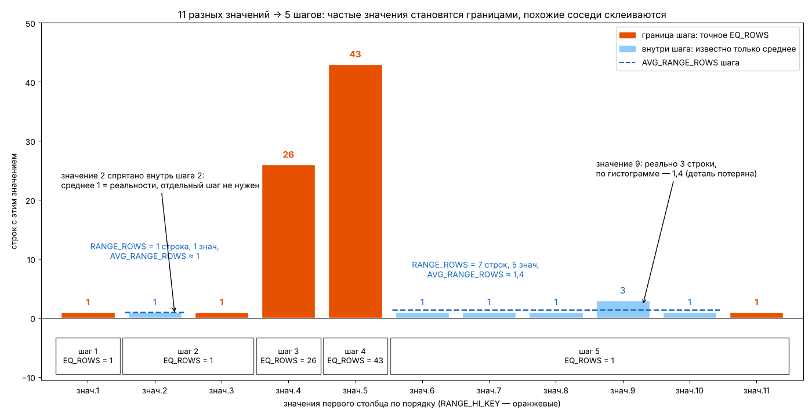

# П10. Статистика регистра 1С на живых данных

[← Sort в запросах 1С](19-sort-1c-experiments.md) · [Оглавление](../README.md) · [Шпаргалка →](10-cheatsheet.md)

Одна статистика — индекса `_InfoRg45092_1` периодического регистра сведений — снята дважды: на 40 строках и на 183 строках после загрузки. Между снимками проверено автообновление, а пересчёт пойман в Profiler. Цель — прочитать `DBCC SHOW_STATISTICS` на настоящих данных 1С, сверить три части вывода между собой и проверить утверждения теории. Часть утверждений не подтвердилась, в том числе одно из [вопроса 30а](04-statistics.md#30а-шаги-гистограммы-что-показывают-как-строятся-и-как-используются): это отмечено ⚠️.

Скрипт для своей таблицы — [`24_statistics_1c_register_check.sql`](../sql/24_statistics_1c_register_check.sql).

| № | Что проверяли | Итог |
|---|---|---|
| [3](#3-заголовок-поле-за-полем) | Поля заголовка, включая `Filter Expression`, `Unfiltered Rows`, `Persisted Sample Percent` | Разобраны все |
| [4](#4-средняя-длина-ключа-по-ней-видно-типы-столбцов) | Average Length в векторе плотности | Видны типы столбцов 1С: дата 6 байт, ссылка 16 байт |
| [5](#5-сверка-трёх-частей-между-собой) | Сходятся ли заголовок, плотность и гистограмма | Сходятся до единицы |
| [6](#6-шагов-меньше-чем-разных-значений-хотя-до-200-далеко) | «≤ 200 разных значений → по шагу на значение» | **Не подтвердилось**: 105 значений, 86 шагов |
| [7](#7-перекос-две-оценки-одного-условия) | Перекос и две оценки одного условия | 43 по гистограмме против 1,74 по плотности |
| [8](#8-что-изменилось-между-снимками) | Что видно при сравнении двух снимков | Часть старых строк исчезла: регистр перезаписывали |
| [9](#9-почему-статистика-не-обновилась) | Почему статистика не обновилась после вставки | Порог не достигнут; заголовок — снимок |
| [10](#10-каким-запросом-строится-статистика) | Каким запросом строится статистика | Обычный `SELECT` с агрегатом `StatMan`, пойман в трассе |
| [11](#11-как-поймать-запрос-statman-в-profiler) | Как поймать его в Profiler | Пошагово |
| [12](#12-частые-заблуждения) | Типичные ошибки объяснений | Таблица |

---

## 1. Объект

Регистр сведений с периодичностью, таблица `dbo._InfoRg45092`. Индекс `_InfoRg45092_1` — **Период + измерения**, некластерный уникальный ([вопрос 77](08-1c-specifics.md#77-как-индексы-объектов-1с-отображаются-в-индексы-субд)): `_Period`, `_Fld45093` (строковое измерение), `_Fld45094RRef`, `_Fld45095RRef`, `_Fld47048RRef` (ссылки). Ключ кластеризации регистра — те же столбцы в другом порядке, поэтому SQL Server ничего неявно в этот индекс не добавляет.

Год **4026** вместо 2026 — смещение дат 1С на 2000 лет ([вопрос 68](08-1c-specifics.md#68-как-запрос-1с-транслируется-в-sql-как-понять-объект-по-имени-таблицы)). Исправлять его не нужно.

## 2. Два снимка

```sql
DBCC SHOW_STATISTICS (N'dbo._InfoRg45092', N'_InfoRg45092_1');
```

**Заголовок:**

| Снимок | Updated | Rows | Rows Sampled | Steps | Density | Average key length | String Index | Filter Expression | Unfiltered Rows | Persisted Sample Percent |
|---|---|---|---|---|---|---|---|---|---|---|
| 1 | окт 12 2026 8:32PM | 40 | 40 | 27 | 1 | 131,4 | NO | NULL | 40 | 0 |
| 2 | окт 14 2026 7:32PM | 183 | 183 | 86 | 1 | 127,1803 | NO | NULL | 183 | 0 |

**Вектор плотности:**

| Columns | Снимок 1: All density | Average Length | Снимок 2: All density | Average Length |
|---|---|---|---|---|
| `_Period` | 0,03448276 | 6 | 0,00952381 | 6 |
| `+ _Fld45093` | 0,025 | 83,4 | 0,005464481 | 79,18033 |
| `+ _Fld45094RRef` | 0,025 | 99,4 | 0,005464481 | 95,18033 |
| `+ _Fld45095RRef` | 0,025 | 115,4 | 0,005464481 | 111,1803 |
| `+ _Fld47048RRef` | 0,025 | 131,4 | 0,005464481 | 127,1803 |

**Гистограмма снимка 2** — 86 шагов, характерные строки:

| RANGE_HI_KEY | RANGE_ROWS | EQ_ROWS | DISTINCT_RANGE_ROWS | AVG_RANGE_ROWS |
|---|---|---|---|---|
| 4026-09-23 03:49:38 | 0 | 1 | 0 | 1 |
| 4026-09-30 01:23:13 | 1 | 1 | 1 | 1 |
| 4026-10-06 06:23:58 | 0 | 4 | 0 | 1 |
| … | | | | |
| 4026-10-14 09:04:46 | 0 | **26** | 0 | 1 |
| 4026-10-14 09:04:47 | 0 | **43** | 0 | 1 |
| 4026-10-14 09:04:58 | 1 | 1 | 1 | 1 |
| … | | | | |
| 4026-10-14 09:05:37 | 3 | 1 | 3 | 1 |
| … | | | | |
| 4026-10-14 09:08:31 | 1 | 1 | 1 | 1 |

---

## 3. Заголовок поле за полем

| Поле | Снимок 2 | Что значит |
|---|---|---|
| `Name` | `_InfoRg45092_1` | Статистика создана вместе с индексом и называется так же |
| `Updated` | 14.10, 19:32 | Когда пересчитывали. Важнее даты — `modification_counter` ([вопрос 30](04-statistics.md#как-читать-вывод)) |
| `Rows` | 183 | Строк в таблице **на момент пересчёта**. Это снимок ([раздел 9](#9-почему-статистика-не-обновилась)) |
| `Rows Sampled` | 183 | Сколько строк реально прочитано. Равно `Rows` — полное чтение: маленькая таблица читается целиком всегда ([вопрос 34](04-statistics.md#автоматический-процент-выборки)) |
| `Steps` | 86 | Шагов гистограммы, предел 200 |
| `Density` | 1 | Устаревшее поле, оптимизатор его не использует |
| `Average key length` | 127,18 | Средняя длина полного ключа в байтах = последняя строка Average Length вектора плотности |
| `String Index` | NO | Строковой сводки нет: первый столбец — дата, а сводка строится только для строкового **первого** столбца и помогает оценивать `LIKE '%…%'` |
| `Filter Expression` | NULL | Статистика не фильтрованная |
| `Unfiltered Rows` | 183 | Строк во всей таблице на момент пересчёта. У нефильтрованной статистики всегда равно `Rows` |
| `Persisted Sample Percent` | 0 | Процент выборки не закреплён |

**Filter Expression и Unfiltered Rows** нужны у **фильтрованной** статистики: созданной вручную с `WHERE` или вместе с фильтрованным индексом. Пример:

```sql
CREATE STATISTICS st_InfoRg45092_Fresh ON dbo._InfoRg45092 (_Period)
WHERE _Period >= '4026-10-01';
```

| Поле | Значение | Смысл |
|---|---|---|
| `Filter Expression` | `([_Period]>='4026-10-01 00:00:00')` | Условие отбора строк |
| `Rows` | например, 160 | Строк, **прошедших фильтр**: гистограмма и плотность построены только по ним |
| `Unfiltered Rows` | 183 | Строк **во всей таблице** |

Смысл фильтрованной статистики — свои 200 шагов на нужный участок данных ([вопрос 31](04-statistics.md#31-почему-не-больше-200-шагов-и-к-чему-это-приводит)). Платформа 1С фильтрованных индексов и статистик не создаёт: их добавляет администратор БД.

**Persisted Sample Percent** показывает процент выборки, закреплённый для **будущих** автообновлений:

```sql
UPDATE STATISTICS dbo._InfoRg45092 _InfoRg45092_1
WITH SAMPLE 30 PERCENT, PERSIST_SAMPLE_PERCENT = ON;   -- в поле будет 30
```

Без закрепления ручной `FULLSCAN` держится только до ближайшего автообновления: оно снова возьмёт автоматический процент ([вопрос 34, «Ловушка»](04-statistics.md#какая-операция-какой-объём-читает)). 0 — ничего не закреплено.

## 4. Средняя длина ключа: по ней видно типы столбцов

Разница соседних строк `Average Length` — сколько байт добавляет столбец:

| Столбец | Прирост | Тип |
|---|---|---|
| `_Period` | 6 | `datetime2(0)` — 6 байт |
| `_Fld45093` | +77,4 (снимок 1), +73,18 (снимок 2) | Строковое измерение `nvarchar`: в среднем ~37–39 символов по 2 байта. У новых строк строки короче — отсюда уменьшение `Average key length` |
| `_Fld45094RRef`, `_Fld45095RRef`, `_Fld47048RRef` | +16 каждая | Ссылка 1С — `binary(16)` |

Так без схемы таблицы видно, что ключ индекса на две трети состоит из строки: широкий ключ — меньше строк на странице индекса.

## 5. Сверка трёх частей между собой

Части вывода не независимы. Две проверки:

> **SUM(EQ_ROWS) + SUM(RANGE_ROWS) = Rows**
>
> **Steps + SUM(DISTINCT_RANGE_ROWS) = 1 / density первого столбца** — число разных значений

| | Снимок 1 | Снимок 2 |
|---|---|---|
| SUM(EQ_ROWS) | 38 | 164 |
| SUM(RANGE_ROWS) | 2 | 19 |
| Итого = Rows | **40** ✓ | **183** ✓ |
| Steps | 27 | 86 |
| SUM(DISTINCT_RANGE_ROWS) | 2 | 19 |
| Разных `_Period` | **29** | **105** |
| 1 / density(`_Period`) | 1 / 0,03448276 = **29** ✓ | 1 / 0,00952381 = **105** ✓ |
| 1 / density(полный ключ) | 1 / 0,025 = **40** = Rows | 1 / 0,005464481 = **183** = Rows |

Последняя строка — свойство **уникального** индекса: плотность полного ключа всегда 1 / Rows. Здесь уникальна уже пара «период + первое измерение»: следующие столбцы плотность не меняют.

При выборке (`Rows Sampled < Rows`) числа экстраполированы, дробные, и равенства выполняются приблизительно. Сверку для своей таблицы делает блок 3 [скрипта 24](../sql/24_statistics_1c_register_check.sql).

---

## 6. Шагов меньше, чем разных значений, хотя до 200 далеко

⚠️ **Утверждение** ([вопрос 30а](04-statistics.md#как-строятся-шаги), шпаргалка, многие статьи): если разных значений не больше 200, каждое становится отдельным шагом, `RANGE_ROWS = 0`, гистограмма точная.

**Факт:** 105 разных значений `_Period` — и **86** шагов. В 17 шагах `RANGE_ROWS > 0`: 19 значений лежат **внутри** промежутков. На 40 строках то же самое: 29 значений, 27 шагов.

Правильная формулировка: **200 — только верхний предел.** Алгоритм не обязан выделять каждому значению шаг. Он склеивает соседние значения, если это **не портит оценку**. У всех 19 «спрятанных» значений по одной строке, и `AVG_RANGE_ROWS = 1` совпадает с реальностью: отдельный шаг дал бы ту же оценку. Посмотрите шаг `09:05:37`: `RANGE_ROWS = 3`, `DISTINCT_RANGE_ROWS = 3`, `AVG_RANGE_ROWS = 1` — три уникальных значения внутри, каждое по одной строке. Поэтому `COUNT(DISTINCT _Period)` вернёт 105, а не 86.

**Аналогия.** Вахтёр общежития ведёт учёт жильцов в блокноте, где строк меньше, чем комнат:

1. Первую и последнюю комнату записывает всегда — это границы диапазона.
2. Большие комнаты (26 и 43 жильца) записывает **отдельно и точно**: спрячь их в группу «комнаты 4–8: 72 человека» — и на вопрос «сколько в комнате 6?» придётся ответить «≈ 14», хотя там один.
3. Похожие маленькие комнаты склеивает в одну строку: «после пятой и до одиннадцатой — 7 человек в 5 комнатах, в среднем 1,4».
4. Цена склейки: в комнате 9 живут трое, а по блокноту видно только среднее 1,4.



| Общежитие | Статистика |
|---|---|
| Комнаты по порядку номеров | Отсортированные значения первого столбца |
| Жильцов в комнате | Строк с этим значением |
| Блокнот на 200 строк | Предел 200 шагов |
| Комната, записанная отдельно | `RANGE_HI_KEY` + `EQ_ROWS` |
| «Между ними N человек в M комнатах» | `RANGE_ROWS` / `DISTINCT_RANGE_ROWS` |
| «В среднем по столько-то» | `AVG_RANGE_ROWS` |

Число шагов — не настройка, а **результат сжатия**: сколько значений «выделяются» и требуют своей строки, а сколько можно склеить без потерь. Что важно для оценок, это не меняет: значение-граница оценивается точно (`EQ_ROWS`), значение внутри шага — по среднему ([вопрос 32](04-statistics.md#32-оценка-предиката-равенства)).

---

## 7. Перекос: две оценки одного условия

В снимке 2 два значения занимают **69 строк из 183, 38% таблицы**: `09:04:46` — 26 строк, `09:04:47` — 43. Остальные периоды встречаются 1–4 раза. Как и обещает алгоритм, оба пика стали границами шагов.

| Условие | Откуда оценка | Оценка | Факт |
|---|---|---|---|
| `WHERE _Period = '4026-10-14 09:04:47'` (литерал) | Гистограмма: `EQ_ROWS` | **43** | 43 |
| `DECLARE @p …; WHERE _Period = @p` (локальная переменная) | Плотность: 183 × 0,00952381 | **1,74** | 43 — ошибка в 25 раз |
| `GROUP BY _Period` | 1 / density | 105 групп | 105 |
| `GROUP BY _Period, _Fld45093` | 1 / density пары | 183 группы | 183 |

1С передаёт значения параметрами через `sp_executesql`: при первой компиляции значение «подсматривается», оценка берётся из гистограммы, план кэшируется. Если первым пришёл период на 43 строки, а потом — на одну, второй вызов идёт по чужому плану. На 183 строках это безвредно. На большом регистре с таким же перекосом — классический parameter sniffing ([вопрос 56](06-params-cache.md#56-parameter-sniffing), [П6](16-sniffing-real-plans.md)). Блок 6 [скрипта 24](../sql/24_statistics_1c_register_check.sql) показывает все три варианта.

## 8. Что изменилось между снимками

По гистограмме снимка 2 данные лежат тремя пачками:

| Период | Строк | Что это |
|---|---|---|
| 23.09 – 12.10 03:04 | 34 | Старые данные |
| 12.10 23:21 – 23:32 | 11 | Небольшая порция записей за 10 минут |
| 14.10 09:04:46 – 09:08:31 | 138 | Загрузка за 4 минуты |

В том же диапазоне дат (до 12.10 03:07:52) снимок 1 насчитывал **40** строк, снимок 2 — **34**:

| Шаг снимка 1 | Было | Стало |
|---|---|---|
| 4026-09-30 00:39:15 | 1 | нет |
| 4026-10-09 06:04:51 | 4 | 1 |
| 4026-10-12 02:51:13 | 1 | нет |
| 4026-10-12 03:07:52 | 1 | нет |

Баланс: 40 − 6 + 11 + 138 = 183. Значит, между пересчётами строки не только добавляли, но и **удаляли**. В 1С так работает запись набора записей с отбором: строки по ключу отбора удаляются, новые пишутся. Сравнение двух снимков гистограммы — дешёвый способ заметить такое без журнала регистрации.

## 9. Почему статистика не обновилась

После снимка 1 (40 строк) добавили около 100 строк — статистика не пересчиталась. После снимка 2 (183 строки) таблица выросла до 207 строк, а `Rows` и `Unfiltered Rows` остались 183.

**Причина 1 — заголовок это снимок.** Все поля `DBCC SHOW_STATISTICS`, включая `Rows`, `Unfiltered Rows` и гистограмму, — состояние на момент последнего пересчёта ([вопрос 29а](04-statistics.md#29а-откуда-берётся-число-строк-метаданные-статистика-и-счётчик-изменений)). Текущее число строк — в `sys.dm_db_partition_stats`, накопленные изменения — в `modification_counter`.

**Причина 2 — порог не достигнут.** Таблица была не больше 500 строк, а для таких таблиц порог **500 изменений** ([вопрос 33](04-statistics.md#33-автосоздание-и-автообновление-статистики-порог)). 100 и 24 изменения до него далеко.

> ⚠️ **Динамическая формула MIN(500 + 20%·n; √(1000·n)) действует только для таблиц больше 500 строк.** Если подставить в неё n = 40, получится √40 000 = 200 изменений, для n = 183 — 428. Так считать неверно: до 500 строк порог всегда 500. Ошибка встречается и в объяснениях чат-ботов, и в нашем первом разборе этих снимков.

**Причина 3 — обновление ленивое.** Даже после порога статистика пересчитается только при компиляции запроса, которому она нужна ([вопрос 33, «Автообновление ленивое»](04-statistics.md#автообновление-ленивое-что-из-этого-следует)).

```sql
SELECT s.name, sp.last_updated, sp.rows AS rows_in_snapshot, sp.unfiltered_rows,
       sp.modification_counter,
       (SELECT SUM(row_count) FROM sys.dm_db_partition_stats
         WHERE object_id = s.object_id AND index_id IN (0, 1)) AS rows_now
FROM sys.stats s
CROSS APPLY sys.dm_db_stats_properties(s.object_id, s.stats_id) sp
WHERE s.object_id = OBJECT_ID(N'dbo._InfoRg45092');
-- rows_in_snapshot = 183, rows_now = 207, modification_counter ≈ 24
```

Пересчитать вручную: `UPDATE STATISTICS dbo._InfoRg45092 _InfoRg45092_1 WITH FULLSCAN;`. После него `Rows = Unfiltered Rows = 207`.

---

## 10. Каким запросом строится статистика

Распространённое объяснение «статистика строится не запросом, а внутренним механизмом, читающим страницы напрямую» неверно. Пересчёт — это **обычный `SELECT`**, который движок генерирует сам. Его видно в трассе. Пойман при `UPDATE STATISTICS dbo._InfoRg45092 _InfoRg45092_1 WITH FULLSCAN`:

```sql
SELECT StatMan([SC0], [SC1], [SC2], [SC3], [SC4])
FROM (
    SELECT TOP 100 PERCENT
           [_Period]       AS [SC0],
           [_Fld45093]     AS [SC1],
           [_Fld45094RRef] AS [SC2],
           [_Fld45095RRef] AS [SC3],
           [_Fld47048RRef] AS [SC4]
    FROM [dbo].[_InfoRg45092] WITH (READUNCOMMITTED)
    ORDER BY [SC0], [SC1], [SC2], [SC3], [SC4]
) AS _MS_UPDSTATS_TBL
OPTION (MAXDOP 6)
```

| Часть | Смысл |
|---|---|
| `SC0…SC4` | Столбцы статистики в порядке ключа индекса — те же, что в векторе плотности |
| Нет `TABLESAMPLE` | Полное чтение. При выборке появляется `TABLESAMPLE SYSTEM (N PERCENT)` — выборка **по страницам** ([вопрос 34](04-statistics.md#выборка-идёт-по-страницам-а-не-по-строкам)) |
| `WITH (READUNCOMMITTED)` | Чтение без разделяемых блокировок: пересчёт не ждёт транзакций 1С и не блокирует их. Незафиксированные строки для оценки распределения некритичны |
| `TOP 100 PERCENT … ORDER BY` | Технический приём: в подзапросе T-SQL не разрешает `ORDER BY` без `TOP`. Сортировка нужна по **всем** столбцам |
| `StatMan` | Внутренний агрегат. За **один проход** по отсортированному потоку строит гистограмму по `SC0` (где меняется значение — заканчивается группа) и считает смены значений для каждого префикса — отсюда плотность всех строк вектора |
| `OPTION (MAXDOP 6)` | Предел параллелизма. Берётся из настройки MAXDOP сервера или базы; на 200 строках параллелизм не включится |

**Выполнить его самому нельзя:** `StatMan` доступна только движку, SSMS ответит «'StatMan' is not a recognized built-in function name». Тот же расчёт обычными запросами — блоки 4 и 5 [скрипта 24](../sql/24_statistics_1c_register_check.sql).

**Нужен ли Sort.** Индекс `_InfoRg45092_1` уже упорядочен ровно по `SC0…SC4`, поэтому оптимизатор может читать его по порядку (Index Scan, `Ordered = True`) без оператора Sort. Проверка — блок 9 скрипта 24: подзапрос без `StatMan` с фактическим планом. Иначе выглядит пересчёт **по выборке** или автосоздание `_WA_Sys_`: страницы читаются из кластерного индекса в случайном порядке, и в плане есть Sort, а в тексте — `step_direction` и `STATMANMERGE`. Такие планы — в [П9, опыт 10](19-sort-1c-experiments.md#10-sort-которого-вы-не-писали-построение-статистики).

Вывод: `FULLSCAN` на регистре в десятки миллионов строк стоит столько же, сколько полное сканирование индекса плюс, возможно, сортировка. Поэтому его делают в окно обслуживания.

## 11. Как поймать запрос StatMan в Profiler

Нужно право `ALTER TRACE`. Общий порядок работы с Profiler для запросов 1С — [вопрос 69а](08-1c-specifics.md#69а-практика-как-поймать-свой-запрос-1с-в-profiler-и-получить-его-план).

1. **Tools → SQL Server Profiler**, подключиться к серверу базы.
2. **Trace Properties → General**: шаблон **Blank**.
3. **Events Selection**, отметить **Show all events** и **Show all columns**, включить:

   | Раздел | Событие | Зачем |
   |---|---|---|
   | Stored Procedures | **SP:StmtCompleted** | Сюда попадает `SELECT StatMan(...)` |
   | TSQL | **SQL:StmtCompleted** | Ваша команда `UPDATE STATISTICS` |
   | Performance | **Auto Stats** | Автосоздание и автообновление при компиляции |

   Колонки: TextData, DatabaseName, ObjectName, Duration, Reads, CPU, SPID, StartTime.
4. **Column Filters**: `TextData` **Like** `%StatMan%` и `%UPDATE STATISTICS%` (значения одной колонки объединяются через ИЛИ); `DatabaseName` **Like** имя базы. У Auto Stats `TextData` пустой, и такой фильтр его отсечёт: для автообновлений нужна отдельная трасса только с фильтром по базе.
5. **Run**, затем в SSMS: `UPDATE STATISTICS dbo._InfoRg45092 _InfoRg45092_1 WITH FULLSCAN;`
6. В трассе: **SP:StmtCompleted** с `SELECT StatMan(...)` и **SQL:StmtCompleted** с вашей командой. Duration, Reads и CPU у первой строки — цена построения статистики.
7. Повторить с `WITH SAMPLE 50 PERCENT`: в тексте появится `TABLESAMPLE`.
8. **Автообновление:** трасса с Auto Stats и SP:StmtCompleted, фильтр только по базе. Изменить больше строк, чем порог (`modification_counter` > порога из блока 1 скрипта 24), и выполнить запрос с условием по `_Period`. Рядом появятся **Auto Stats** и тот же `SELECT StatMan(...)` — статистику пересчитала компиляция вашего запроса, а не вставка строк.
9. Остановить трассу. Profiler нагружает сервер: на рабочей базе — короткое время и только с фильтрами.

То же через Extended Events (события `sp_statement_completed`, `sql_statement_completed`, `auto_stats`) — блок 8 [скрипта 24](../sql/24_statistics_1c_register_check.sql).

---

## 12. Частые заблуждения

Собраны из разборов этих же снимков, в том числе ответов чат-ботов.

| Утверждение | Как на самом деле |
|---|---|
| Шагов = MIN(разных значений, 200); при ≤ 200 значений гистограмма «идеальная» | 200 — предел. Соседние значения склеиваются, если это не портит оценку: 105 значений → 86 шагов ([раздел 6](#6-шагов-меньше-чем-разных-значений-хотя-до-200-далеко)) |
| Для таблиц до 500 строк автообновление срабатывает при любом изменении | Порог — 500 изменений ([раздел 9](#9-почему-статистика-не-обновилась)) |
| Для таблиц до 500 строк порог считается по √(1000·n) | Динамическая формула — только для n > 500 |
| Статистика строится не запросом, а прямым чтением страниц | Обычный `SELECT … StatMan(…)`, виден в трассе ([раздел 10](#10-каким-запросом-строится-статистика)) |
| `String Index` — «сжатие длинных строк» | Строковая сводка для оценки `LIKE`, строится только для строкового первого столбца |
| Выборка обычно 20–30% страниц | Процент падает с ростом таблицы, на больших таблицах — единицы процентов и меньше ([вопрос 34](04-statistics.md#автоматический-процент-выборки)) |
| `sys.partitions.rows` неточен, «если статистика устарела» | Со статистикой не связан ([вопрос 29а](04-statistics.md#1-текущее-число-строк--метаданные-таблицы)) |
| Гистограмму оптимизатор перебирает «при каждом выполнении» | При **компиляции**. План из кэша статистику не читает |
| `SELECT p.rows AS RowCount …` | Синтаксическая ошибка: `ROWCOUNT` — зарезервированное слово. Нужно `[RowCount]` |
| Обновление статистики в 1С делает обработка платформы с `RESAMPLE` | Не подтверждено. Регламент — средствами SQL Server: Maintenance Plan, `sp_updatestats`, `UPDATE STATISTICS` ([вопрос 33](04-statistics.md#управление-статистикой-команды)) |

## 13. Выводы

1. **Три части вывода сверяются:** `ΣEQ + ΣRANGE = Rows`, `Steps + ΣDISTINCT = 1 / density`. Не сходится при полном чтении — читаете не ту статистику или не тот снимок.
2. **200 шагов — предел, а не правило.** Сколько шагов получится, решает сжатие: пики становятся границами, похожие соседи склеиваются.
3. **Перекос виден по большим `EQ_ROWS`.** Там же расходятся оценка по гистограмме и по плотности — источник parameter sniffing.
4. **Заголовок статистики — снимок.** Текущее число строк — в метаданных, отставание — в `modification_counter`. Маленькой таблице нужно 500 изменений до автообновления.
5. **Сравнение двух снимков** показывает не только рост, но и удаления — перезапись наборов записей 1С.
6. **Пересчёт статистики — обычный `SELECT`** с агрегатом `StatMan`: его видно в Profiler и XE, а его стоимость — это стоимость сканирования индекса.

---

[← Sort в запросах 1С](19-sort-1c-experiments.md) · [Оглавление](../README.md) · [Шпаргалка →](10-cheatsheet.md)
